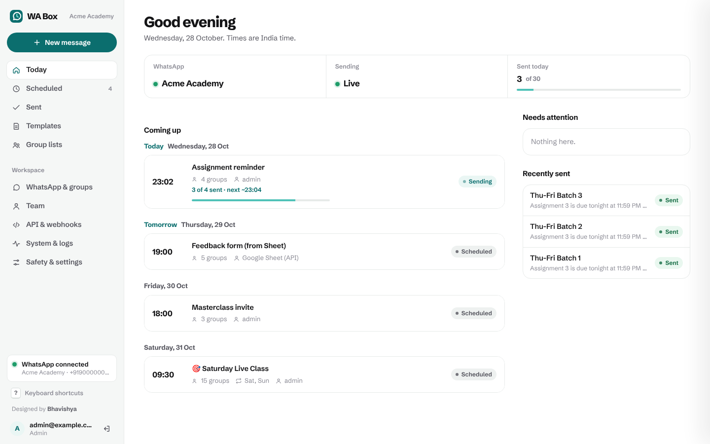
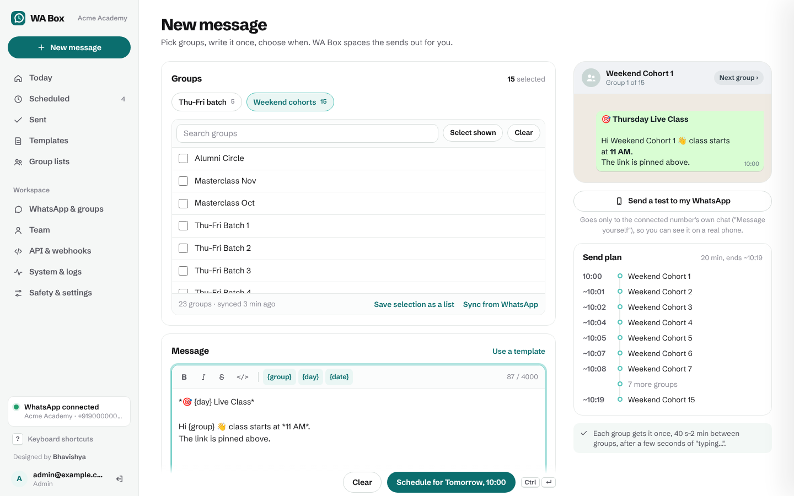
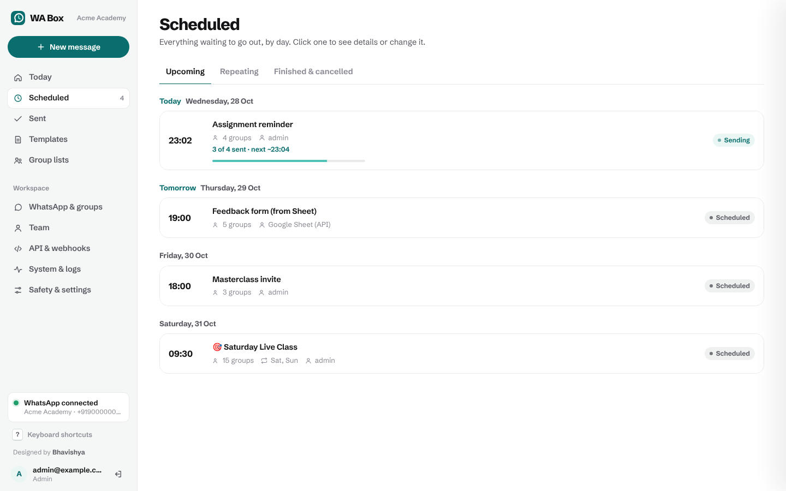
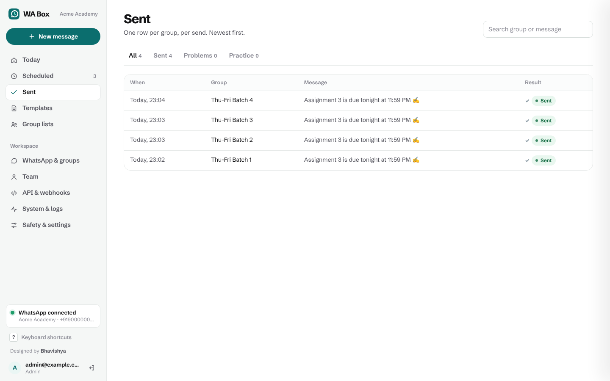
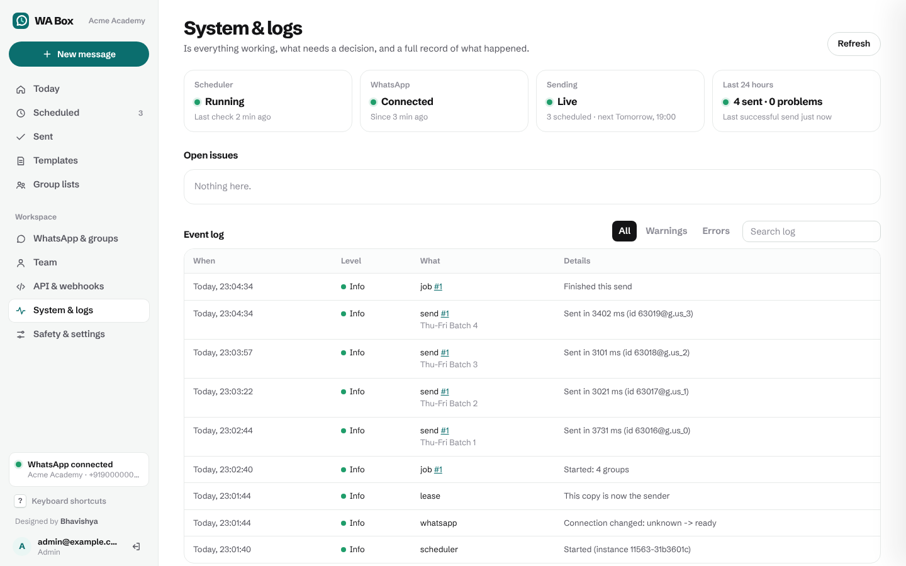
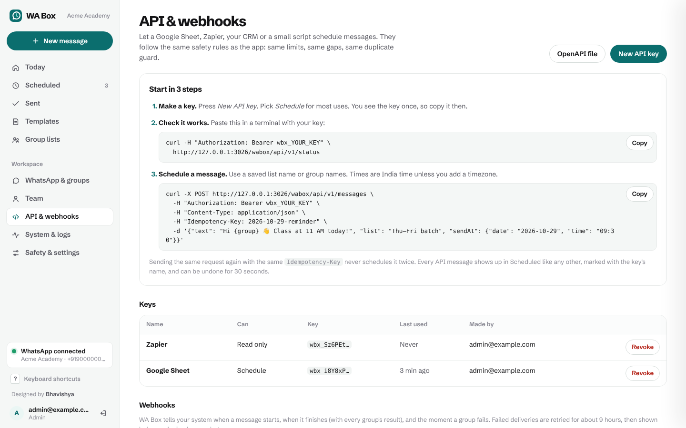
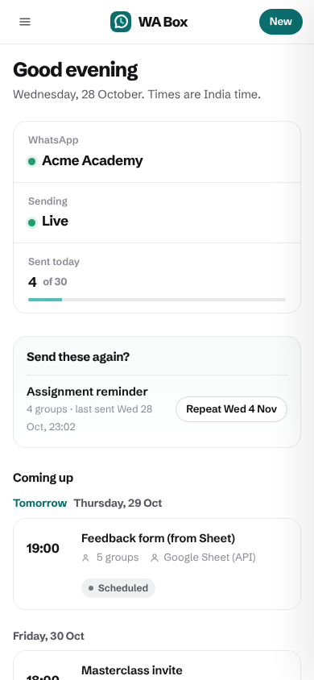

<p align="center">
  <picture>
    <source media="(prefers-color-scheme: dark)" srcset="docs/assets/logo-dark.svg">
    
  </picture>
</p>

<p align="center">
  <b>Schedule messages to your WhatsApp groups, safely, as a team.</b><br>
  Write once, pick the groups, pick a time. WA Box sends to each group with natural, random gaps,<br>
  checks every send, never sends twice, and tells you the moment anything goes wrong.
</p>

<p align="center">
  <a href="#get-started">Get started</a> ·
  <a href="docs/USER-GUIDE.md">User guide</a> ·
  <a href="docs/API.md">API</a> ·
  <a href="RUNBOOK.md">Runbook</a> ·
  <a href="#install-with-your-ai-assistant">Install with your AI assistant</a>
</p>

<p align="center">
  
</p>

---

## Why WA Box

If you run cohorts, communities or classes on WhatsApp, you send the same message to 5, 15, 30
groups, at the same times every week, often early on a Saturday. WhatsApp has no scheduler, and
blasting 15 groups in 15 seconds from a script is a good way to get a number flagged.

WA Box is a small web app your whole team can use:

- **It feels like WhatsApp.** A live phone preview with your formatting, emoji, images and link cards, exactly as each group will see it.
- **It sends like a person.** One group at a time, a random gap between each, "typing…" before each message, daily and hourly limits.
- **It never sends twice.** Every send is written down before it happens. If anything is unclear after a crash or a dropped connection, WA Box reads the group's chat to check, and asks you instead of guessing.
- **Nothing fails quietly.** Missed, failed, unconfirmed or blocked sends show up on Today, in a morning check-in, and in your Slack, Google Chat, Discord or WhatsApp.
- **It runs on your own server**, with your own WhatsApp number linked like WhatsApp Web. No third-party service sees your messages.

---

## What it looks like

| | |
|---|---|
| <br>**Write.** Live WhatsApp preview per group, `{group}` `{day}` `{date}` placeholders, saved lists, templates, and a date sense-check ("says Saturday but sends on Friday"). | <br>**Plan.** Everything coming up, by day. Weekly repeats, edit, duplicate, send now, undo. |
| <br>**Know.** Every group, every send, with WhatsApp's ✓ ✓✓ ticks and plain-English reasons for anything that didn't go. | <br>**Trust.** Health, decisions waiting for you, open issues and a full event log. |
| <br>**Connect.** Scoped API keys, signed webhooks, ready-to-paste examples. | <br>**Anywhere.** Works on a phone, so a Saturday-morning check takes ten seconds. |

---

## Features

**Writing**
- WhatsApp formatting (`*bold*`, `_italic_`, `~strike~`, ```` ```mono``` ````, lists, quotes) with toolbar and shortcuts (Ctrl/⌘ + B, I, Enter).
- Live phone preview that steps through each group, showing exactly what that group gets.
- Placeholders filled in per group: `{group}`, `{day}`, `{date}`.
- **Date sense-check**: catches "today" + "Saturday" when it actually sends Friday, "11 AM today" sent at 12:30, last week's date, and weekly messages with a fixed day. One click fixes it.
- Images by upload (deleted automatically after sending) or by link (nothing stored; Google Drive links work), and link preview cards on or off.
- Templates and saved group lists ("Weekend cohorts", "Thu–Fri batch").
- "Send a test to my WhatsApp" before it goes out.

**Scheduling**
- Any date and time (India time), or every week on chosen days.
- Lists remember when you usually send them ("usually Saturday 09:30, gentle pacing").
- Quiet-hours warning, so nothing lands at 2 AM by accident.
- 30-second undo on everything you schedule, including from the API.
- "Send these again?": last week's messages offered back to you on Today.

**Sending safely**
- One message at a time, one group at a time, random gaps (never under 30 s), "typing…" first.
- Daily and hourly limits. Over the limit, the rest go out the next morning, not at midnight.
- Duplicate guard: the same text can't go to the same group twice within 20 hours, even from two different messages.
- Write-ahead record of every send. After a crash or timeout it checks the chat before deciding. Anything it can't confirm is marked **unconfirmed** and waits for a person. It is never resent blindly.
- Circuit breaker: three failures in a row pause all sending and alert you.
- Too late is too late: a message more than 2 hours late (server was off, phone was offline) is marked missed, not sent at an odd hour.
- Practice mode: everything runs on schedule, nothing reaches WhatsApp.

**Knowing what happened**
- Today page: what's sending right now, live, with what's next.
- ✓ sent, ✓✓ delivered, blue ✓✓ read, per group.
- Alerts to Slack, Google Chat, Discord or WhatsApp numbers. A morning check-in (with a week preview on Mondays). A short "done" note after each message.
- `/health/monitor` for an outside uptime monitor, so you hear about it even if the whole server is down.
- Event log, activity log and CSV exports of everything.

**Team**
- Admins and members. Members write and schedule; admins also connect WhatsApp, manage people and change safety settings.
- Everyone signs in with their own account. Every action is in the activity log.

**API and webhooks**
- `POST /api/v1/messages` from a Google Sheet, Zapier, n8n, a CRM or a script. Same rules as the app.
- Keys with `read` / `schedule` / `full` scope, optionally limited to some group lists. Stored hashed, shown once.
- `Idempotency-Key`, so a retried request never schedules twice.
- Signed webhooks for `message.started`, `message.finished` and `group.failed`, retried for ~9 hours.
- Full reference: [docs/API.md](docs/API.md) and an [OpenAPI 3.1 file](app/public/openapi.yaml).

---

## How it keeps your number safe

WA Box links to WhatsApp the same way WhatsApp Web does, so it is not an official WhatsApp
product, and no tool can promise a number will never be restricted. What WA Box does is behave
like a careful person, and make mistakes very hard:

| Risk | What WA Box does |
|---|---|
| Sending too fast | Random gaps between groups (30 s minimum, enforced on the server), typing indicator, start-time jitter |
| Sending too much | Daily cap (default 30) and hourly cap (default 20), editable by admins only |
| Sending the same thing twice | Write-ahead send log, chat-history check before any retry, duplicate guard across messages |
| Sending to the wrong chat | Groups only (no personal chats), and only groups saved in WA Box that match your keywords |
| Something going wrong at 7 AM on a Saturday | Alerts, morning check-in, uptime monitor endpoint, circuit breaker |
| Getting it wrong while trying it out | Practice mode on by default; local copies always start in practice mode |

Use a number that has been active on WhatsApp for a while, keep the phone online at least weekly,
and send to groups that expect your messages.

---

## Get started

You need **Docker**. Pick one:

### A. On your own computer (5 minutes)

Good for trying it out. Runs at `http://localhost:3000`, only on your computer, in practice mode.

**Mac / Linux**

```bash
git clone <your-repo-link> wabox
cd wabox
sh scripts/setup.sh
```

**Windows** (PowerShell, with [Docker Desktop](https://docs.docker.com/desktop/install/windows-install/) running)

```powershell
git clone <your-repo-link> wabox
cd wabox
powershell -ExecutionPolicy Bypass -File scripts\setup.ps1
```

The script makes a `.env` with fresh secrets, builds (which also runs every safety test), starts
both parts, and prints your sign-in details. Then:

1. Open `http://localhost:3000` and sign in with the printed username and one-time password. Choose your own password.
2. **WhatsApp & groups** → show the QR code → on your phone: WhatsApp → Settings → Linked devices → Link a device → scan.
3. **Sync from WhatsApp**. Set group keywords first if your phone is in many groups.
4. Write your first message. When you're happy, **Safety & settings → Go live**.

Other commands: `make up`, `make down`, `make logs`, `make status`, `make password`, `make update`
(see `make help`). Without `make`: `docker compose -f docker-compose.local.yml up -d --build`.

A local copy keeps running only while your computer is on and awake. For messages that must go
out at 7 AM on a Sunday, use a server.

### B. On a server with Coolify (15 minutes)

1. In Coolify: **New resource → Git repository** (your fork), build pack **Docker Compose**, file `/docker-compose.yml`.
2. Domain for the `wabox` service, e.g. `https://example.com/wabox` (or a whole subdomain; set `BASE_PATH` to match). Give the `engine` service **no** domain.
3. Edit `ADMIN_USER`, `ORG_NAME` and `GROUP_KEYWORDS` in `docker-compose.yml`.
4. Deploy. Coolify generates `SERVICE_PASSWORD_64_ENGINEKEY` and `SERVICE_PASSWORD_ADMIN` (the first admin's password; you change it on first sign-in).
5. Point a free uptime monitor at `https://<your-domain>/wabox/health/monitor`.

### C. Any other Docker host

`docker-compose.yml` works anywhere Compose does. Set `SERVICE_PASSWORD_64_ENGINEKEY` (any long random
string) and `SERVICE_PASSWORD_ADMIN` in the environment, put an HTTPS reverse proxy in front of
port 3000 of `wabox`, and keep the `engine` service private.

---

## Install with your AI assistant

Coding assistants (Claude Code, Cursor, Codex, Copilot, Windsurf, Gemini CLI…) can set WA Box up for
you. The repo has an [`AGENTS.md`](AGENTS.md) that tells them how. Paste one of these:

**Run it on my computer**

```text
Clone <your-repo-link> and set up WA Box on this computer by following its AGENTS.md.
Check Docker is installed and running first, and tell me how to install it if not.
Use admin username: <your email>. Organisation name: <your org>. Group keywords: <e.g. Cohort, Batch>.
When it's running, give me the address, my username and the one-time password, then walk me
through linking WhatsApp. Keep it in practice mode.
```

**Put it on my server**

```text
Clone <your-repo-link> and help me deploy WA Box to my server by following AGENTS.md (section "Deploy").
My server uses <Coolify / plain Docker / ...> and the address should be <https://...>.
Don't put any secrets in git. Keep the engine service private. Tell me exactly what to click
or run, and check the health endpoint at the end.
```

**Connect it to a Google Sheet**

```text
In WA Box (<your WA Box address>), I made an API key. Using docs/API.md, write me a Google Apps
Script for a sheet with columns Date, Time, List, Message, Status that schedules each new row once
(use Idempotency-Key) and writes back the result. Explain how to install it.
```

---

## Using it

The [user guide](docs/USER-GUIDE.md) covers everything, with pictures. In short:

1. **Today** shows what's sending now, what's next, and anything that needs you.
2. **New message**: pick groups or a list, write, check the preview, pick a time, schedule. You have 30 seconds to undo.
3. **Scheduled**: edit, duplicate, send now, or cancel. Just before a weekly message starts you can skip that one week.
4. **Sent**: every group's result and ticks. "It was sent" / "Send again" for anything unclear.
5. **System & logs** and the [runbook](RUNBOOK.md) when something looks wrong.

---

## How it works

```
 Team (browser) ──HTTPS──▶ reverse proxy ──▶ wabox  ──private network──▶ engine ──▶ WhatsApp Web
                                             app + scheduler          headless Chrome
                                             SQLite                    whatsapp-web.js
                                             /api/v1, webhooks         one linked device
```

- **`app/`, the WA Box app**: Node.js 22, Express, SQLite. Serves the web app and the public API, runs the scheduler, keeps every record. The only public service.
- **`engine/`, the WhatsApp engine**: a small private service around [`whatsapp-web.js`](https://github.com/pedroslopez/whatsapp-web.js) running real WhatsApp Web in headless Chrome. Keeps the login, reconnects, restarts Chrome when it misbehaves or grows too big, and falls back to the last WhatsApp Web version that worked. No domain, no published port, API key on every call.
- **The contract between them**: a `4xx` from the engine means *definitely not sent*. Anything else (timeouts, 5xx, dropped connections) means *maybe sent*, and the app checks the group's chat before doing anything. Both sides have tests for this.
- **Evals in the build**: the Docker build runs the full test suite (74 tests acting out real failures: lost replies, crashes mid-send, duplicate jobs, missed weeks, limits, a second copy during a redeploy…). If one fails, the image isn't built and the running version stays up.

### WA Box or a WhatsApp gateway?

A WhatsApp gateway gives developers an API to drive a WhatsApp session. WA Box is a finished
product for one job, with its own small engine on a proven open-source library underneath.

| | A WhatsApp gateway | WA Box |
|---|---|---|
| Who uses it | Developers, through an API | Your whole team, in a web app (plus an API) |
| Scheduling, repeats, lists, templates | Build it yourself | Built in |
| Pacing, daily limits, duplicate guard | Build it yourself | Built in, enforced on the server |
| "Did that actually send?" after a crash | Your problem | Checked against the chat, never blindly resent |
| Alerts, check-ins, uptime endpoint | Build it yourself | Built in |
| Personal chats, bots, auto-replies | Yes | No, on purpose: groups you schedule for |
| Moving parts | Gateway + your code | Two containers |

---

## Configuration

Set in `docker-compose.yml` (server) or `.env` (local copy).

| App (`wabox`) | Default | |
|---|---|---|
| `ADMIN_USER` | `admin` | First admin's username (an email works). |
| `ADMIN_PASSWORD` | random, printed in the logs | First admin's one-time password. Changed on first sign-in. |
| `ORG_NAME` | empty | Shown next to "WA Box". |
| `GROUP_KEYWORDS` | empty (all groups) | Only offer groups whose names contain one of these. Editable in the app. |
| `BASE_PATH` | `/wabox` | Path the app is served under. `/` for a whole domain. |
| `DRY_RUN` | `true` | Start in practice mode. Admins switch it off in the app. |
| `DAILY_CAP` | `30` | Messages per day. Editable in the app. |
| `MAX_LATE_MINUTES` | `120` | Later than this, a send is marked missed instead of going out. |
| `TZ` | `Asia/Kolkata` | Scheduling time zone (WA Box currently works in India time). |
| `WA_ENGINE_URL` / `WA_ENGINE_KEY` | | Where the engine is, and the shared key. |
| `COOKIE_INSECURE` | `false` | `true` only for `http://localhost`. |
| `WABOX_LOCAL` | `false` | Local copy: always starts in practice mode, labelled "Local copy". |
| `WABOX_API_RATE` | `60` | Public API requests per minute per key. |

| Engine (`engine`) | Default | |
|---|---|---|
| `ENGINE_API_KEY` | | Must match the app's `WA_ENGINE_KEY`. |
| `CHROME_MAX_MB` | `1500` | Restart Chrome (between sends) above this memory. |
| `WA_WEB_VERSION` | empty | Pin a WhatsApp Web build if a new one breaks sending. |

Data lives in two volumes: `wabox-data` (messages, users, logs) and `engine-data` (the WhatsApp
login). Back both up.

---

## Development

```bash
cd app && npm ci && npm test        # 61 app tests: scheduler, API, webhooks, writing helpers
cd engine && npm ci && npm test     # 13 engine tests
```

Tests use a fake WhatsApp, so they never touch a real number. See [AGENTS.md](AGENTS.md) for the
code map and the rules any change must keep.

---

## FAQ

**Can it send to people, not groups?** No. WA Box is for groups, by design.

**Does my phone need to stay on?** No, like WhatsApp Web it works with the phone off. Open WhatsApp on the phone at least once a week; linked devices log out after about 14 days without the phone.

**What happens if the server restarts at 9 AM on Saturday?** In-flight sends are checked against the chat. Messages that are a little late go out; ones more than 2 hours late are marked missed and reported. Nothing is sent twice.

**What if WhatsApp changes WhatsApp Web?** The engine retries on the last version that worked. If that isn't enough, update `whatsapp-web.js` and redeploy (see the [runbook](RUNBOOK.md)).

**Is this allowed by WhatsApp?** WA Box is not affiliated with or endorsed by WhatsApp or Meta, and uses WhatsApp Web the way a person would. Read WhatsApp's terms and use it for groups that expect your messages.

---

<p align="center">
  <br>
  <b>WA Box</b> · Designed by <a href="https://www.linkedin.com/in/bhavishyabharadwaj/">Bhavishya</a><br>
  <sub>See <a href="CHANGELOG.md">what's new</a>.</sub>
</p>
