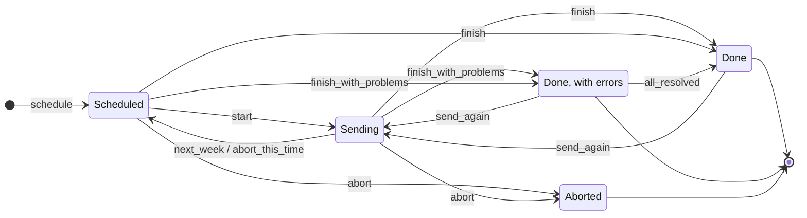
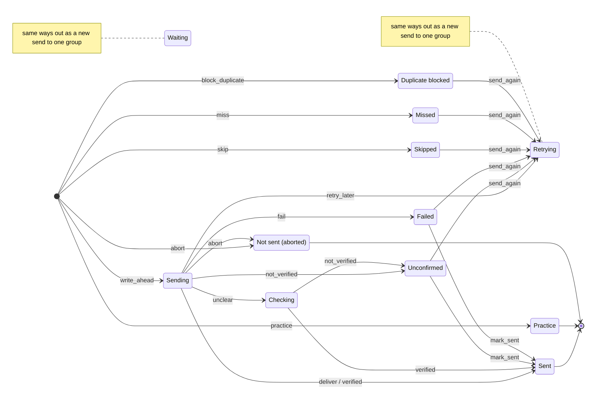
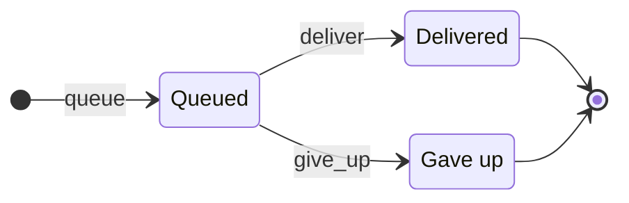
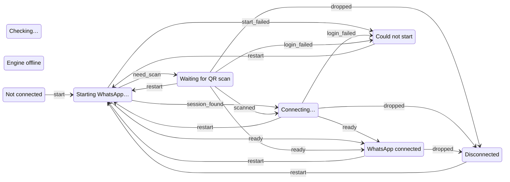
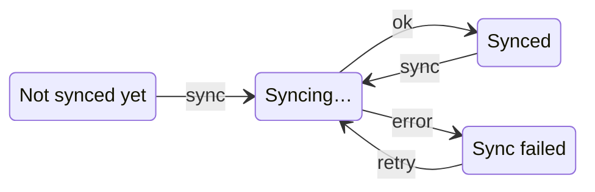
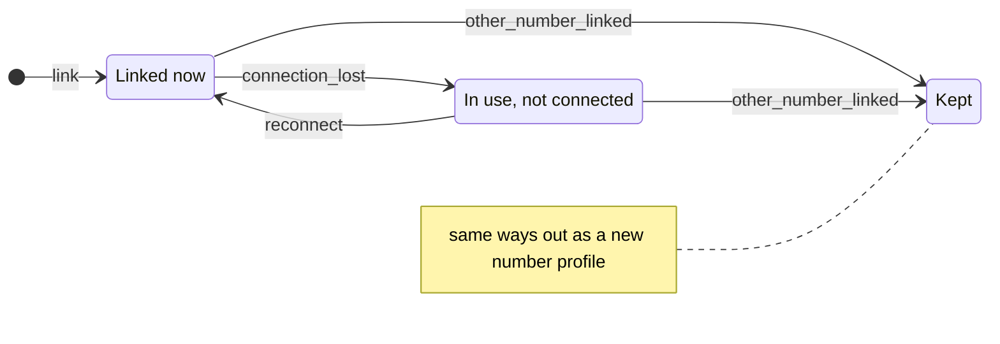
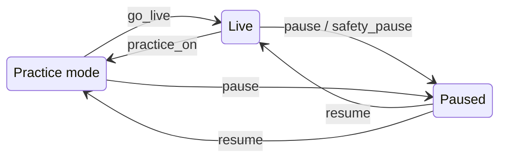
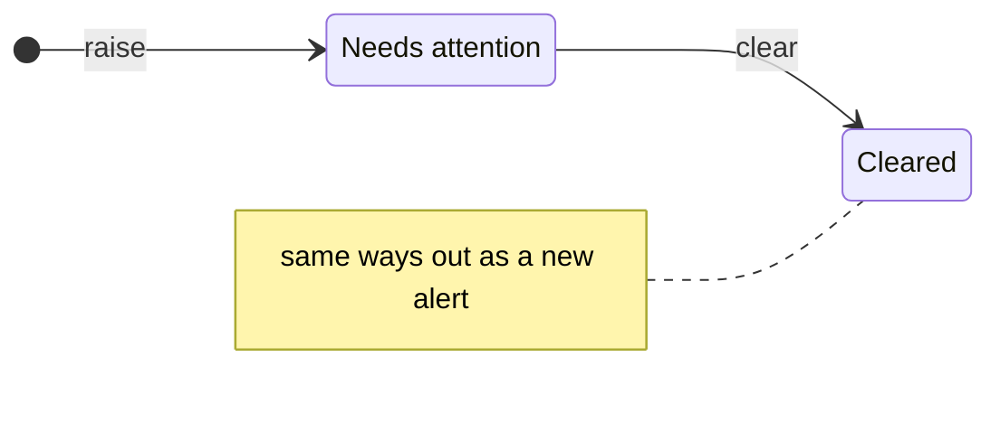
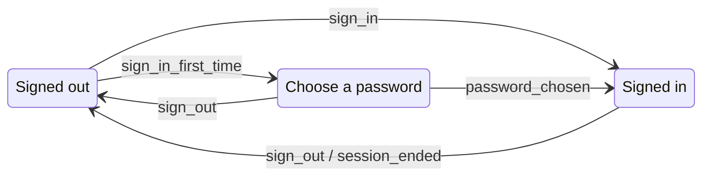

# State machines

<!-- Generated from app/public/machines.js by `cd app && npm run states:doc`. Do not edit by hand. -->

Everything in WA Box that moves through steps is written down as a state machine in
[`app/public/machines.js`](../app/public/machines.js): which states exist, what each one means to a person
(the app shows these words and, on hover, the meaning), and which changes are allowed.
The server, the browser and the tests all read that one file.

**Changing one:** add the state or transition in `machines.js` first, then use it in code, then run
`npm run states:doc`. Never rename a stored state: the names are in the database and the public API.

| Machine | What it is | How it is checked |
|---|---|---|
| [Message](#message) (`job`) | A scheduled message (one-off or weekly). Stored in jobs.status. | database |
| [Send to one group](#send-to-one-group) (`send`) | One message to one group, for one date. Stored in sends.status. Written ahead: "sending" is recorded before the request leaves. | database |
| [Webhook delivery](#webhook-delivery) (`delivery`) | One event posted to one webhook. Stored in hook_deliveries.status. Retries with backoff while pending. | database |
| [WhatsApp connection](#whatsapp-connection) (`connection`) | The linked WhatsApp session in the engine. "unknown" and "unreachable" are how the app sees the engine; the rest come from the engine. | engine |
| [Group sync](#group-sync) (`sync`) | Reading the linked number's groups from WhatsApp (groups.js, in memory, per number). | code |
| [Number profile](#number-profile) (`number`) | Each WhatsApp number that has been linked keeps its own groups, lists and messages. Derived from which number is in use and whether WhatsApp is connected. | code |
| [Sending mode](#sending-mode) (`mode`) | Whether messages really go out. Derived from settings: paused wins over practice. | code |
| [Alert](#alert) (`alert`) | Something a person should know about. Stored in alert_log.open (1 open, 0 cleared); repeats are rate-limited. | code |
| [Sign-in](#sign-in) (`session`) | A person using the web app (auth.js + the first screens in app.js). | code |

## Message

`job` · A scheduled message (one-off or weekly). Stored in jobs.status.

*Checked by the database on every change (a test fails on anything not listed; production logs it under System → Events).*

| State | Shown as | What it means |
|---|---|---|
| `scheduled` | Scheduled | Waiting for its time. You can still edit, reschedule or abort it. |
| `running` | Sending | Going out group by group, with gaps in between. You can abort it or change the rest. |
| `done` (final) | Done | Every group got it. |
| `done_with_errors` (final) | Done, with errors | Some groups didn't get it. Open it to see which, then send again or mark as sent. |
| `cancelled` (final) | Aborted | Aborted before it finished. Groups that already got it keep it. |

Named groups (use these in code instead of listing states):

| Group | States |
|---|---|
| `active` | `scheduled`, `running` |
| `final` | `done`, `done_with_errors`, `cancelled` |
| `canSendAgain` | `scheduled`, `running`, `done`, `done_with_errors` |

## Send to one group

`send` · One message to one group, for one date. Stored in sends.status. Written ahead: "sending" is recorded before the request leaves.

*Checked by the database on every change (a test fails on anything not listed; production logs it under System → Events).*

| State | Shown as | What it means |
|---|---|---|
| `pending` | Waiting | Not sent yet. It goes out in turn. |
| `retry` | Retrying | WhatsApp wasn't ready a moment ago. WA Box tries once more shortly. |
| `sending` | Sending | Going out right now. |
| `uncertain` | Checking | WhatsApp gave no clear answer, so WA Box is looking in the group to see if it arrived. It never resends blindly. |
| `sent` (final) | Sent | The group got it. |
| `dry_run` (final) | Practice | Practice mode: nothing was actually sent. |
| `failed` | Failed | WhatsApp said no, so the group didn't get it. Send again, or mark as sent if it did arrive. |
| `unconfirmed` | Unconfirmed | Unclear if it arrived and WA Box could not check. Look in the group, then mark as sent or send again. |
| `skipped` | Skipped | This number isn't in the group any more (left it, removed, or another number is linked). |
| `missed` | Missed | Its time passed by more than the late limit while WA Box or WhatsApp was offline, so it was not sent late. |
| `blocked_duplicate` | Duplicate blocked | The same message already went to this group recently, so it was blocked. Send again if it really should go twice. |
| `cancelled` (final) | Not sent (aborted) | Aborted before it reached this group. |

Named groups (use these in code instead of listing states):

| Group | States |
|---|---|
| `delivered` | `sent`, `dry_run` |
| `inFlight` | `sending`, `uncertain` |
| `waiting` | `pending`, `retry` |
| `didNotGet` | `failed`, `missed`, `unconfirmed`, `blocked_duplicate`, `skipped` |
| `aborted` | `cancelled` |
| `noResend` | `sent`, `dry_run`, `skipped`, `missed`, `blocked_duplicate`, `unconfirmed` |
| `mayHaveReached` | `sent`, `sending`, `uncertain`, `unconfirmed` |
| `usesBudget` | `sent`, `sending`, `uncertain` |
| `reachedOrReaching` | `sent`, `dry_run`, `sending`, `uncertain` |
| `probablyGotIt` | `sent`, `dry_run`, `uncertain` |
| `unresolved` | `unconfirmed`, `sending`, `uncertain` |

## Webhook delivery

`delivery` · One event posted to one webhook. Stored in hook_deliveries.status. Retries with backoff while pending.

*Checked by the database on every change (a test fails on anything not listed; production logs it under System → Events).*

| State | Shown as | What it means |
|---|---|---|
| `pending` | Queued | Waiting to be posted, or waiting to retry after a failed try. |
| `ok` (final) | Delivered | The webhook answered with 2xx. |
| `failed` (final) | Gave up | No 2xx answer after every retry. An alert was raised. |

## WhatsApp connection

`connection` · The linked WhatsApp session in the engine. "unknown" and "unreachable" are how the app sees the engine; the rest come from the engine.

*Checked by the WhatsApp engine on every change (`engine/src/states.js`, kept equal to this one by a test). Unexpected changes are logged.*

| State | Shown as | What it means |
|---|---|---|
| `unknown` (app only) | Checking… | WA Box has just started and hasn't heard from WhatsApp yet. |
| `unreachable` (app only) | Engine offline | The WhatsApp engine is starting or offline. Scheduled messages wait. |
| `created` | Not connected | The engine is up but hasn't started WhatsApp yet. |
| `initializing` | Starting WhatsApp… | Opening WhatsApp Web. Usually under a minute. |
| `qr_ready` | Waiting for QR scan | Scan the QR code from the phone: WhatsApp → Settings → Linked devices → Link a device. |
| `authenticating` | Connecting… | Logging in with the saved link. |
| `ready` | WhatsApp connected | Linked and ready to send. |
| `disconnected` | Disconnected | The connection dropped (or the phone unlinked it). WA Box restarts it by itself. |
| `failed` | Could not start | WhatsApp failed to start. WA Box retries by itself with growing waits. |

Named groups (use these in code instead of listing states):

| Group | States |
|---|---|
| `starting` | `unknown`, `created`, `initializing`, `authenticating` |

## Group sync

`sync` · Reading the linked number's groups from WhatsApp (groups.js, in memory, per number).

*Held in memory or worked out from other data; the code that changes it uses these names.*

| State | Shown as | What it means |
|---|---|---|
| `never` | Not synced yet | Groups sync by themselves a minute after the number connects. |
| `syncing` | Syncing… | Reading every group on this number. |
| `synced` | Synced | Groups are up to date. They refresh every 6 hours, or press Sync groups now. |
| `failed` | Sync failed | WA Box tries again by itself in 2 minutes. |

## Number profile

`number` · Each WhatsApp number that has been linked keeps its own groups, lists and messages. Derived from which number is in use and whether WhatsApp is connected.

*Held in memory or worked out from other data; the code that changes it uses these names.*

| State | Shown as | What it means |
|---|---|---|
| `linked` | Linked now | Its messages send. |
| `not_connected` | In use, not connected | The number in use, but WhatsApp isn't connected right now. Its messages wait. |
| `kept` | Kept | Linked before. Its messages wait until it's linked again. |

## Sending mode

`mode` · Whether messages really go out. Derived from settings: paused wins over practice.

*Held in memory or worked out from other data; the code that changes it uses these names.*

| State | Shown as | What it means |
|---|---|---|
| `practice` | Practice mode | Nothing is actually sent. Local copies always start here. |
| `live` | Live | Messages really go out. |
| `paused` | Paused | Nothing goes out until someone resumes. The safety pause does this after repeated failures. |

## Alert

`alert` · Something a person should know about. Stored in alert_log.open (1 open, 0 cleared); repeats are rate-limited.

*Held in memory or worked out from other data; the code that changes it uses these names.*

| State | Shown as | What it means |
|---|---|---|
| `open` | Needs attention | Shown as an issue until it clears or someone fixes it. |
| `cleared` | Cleared | Fixed or no longer true. |

## Sign-in

`session` · A person using the web app (auth.js + the first screens in app.js).

*Held in memory or worked out from other data; the code that changes it uses these names.*

| State | Shown as | What it means |
|---|---|---|
| `signed_out` | Signed out | Sign in with your email and password. |
| `must_change_password` | Choose a password | First sign-in with a one-time password: choose your own. |
| `signed_in` | Signed in | Using WA Box. |
