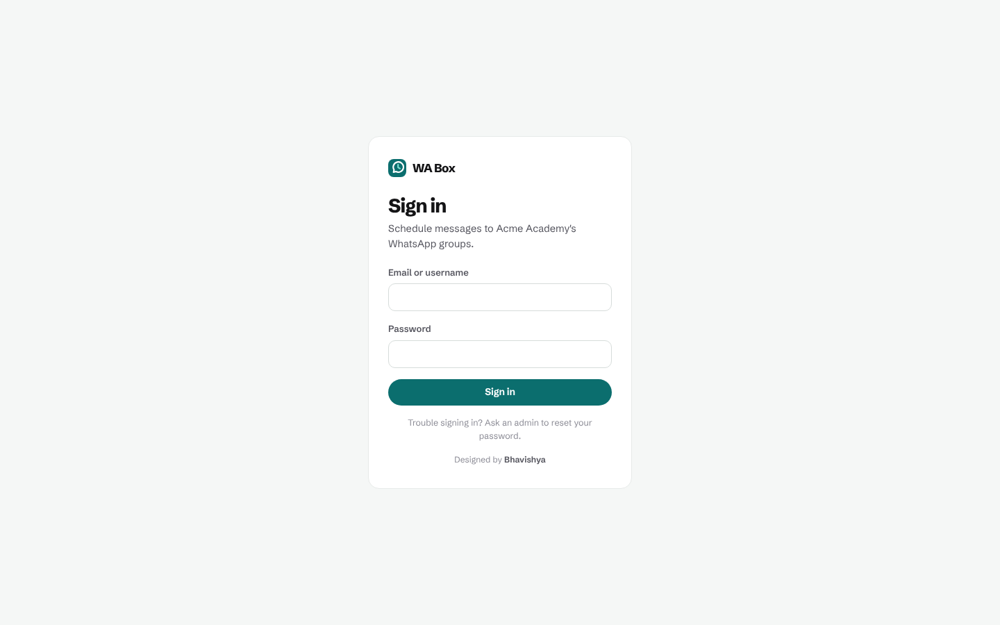
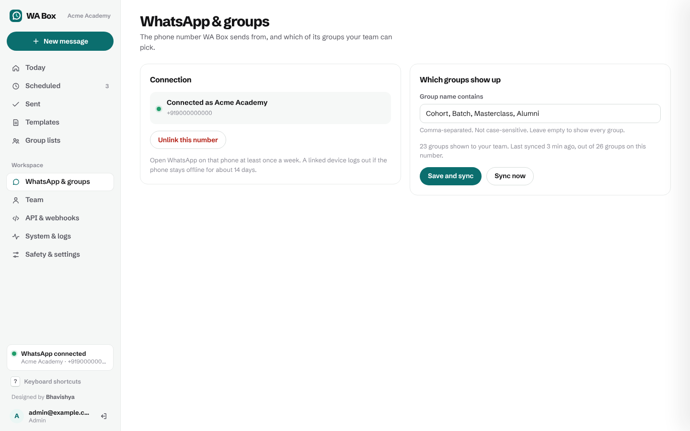
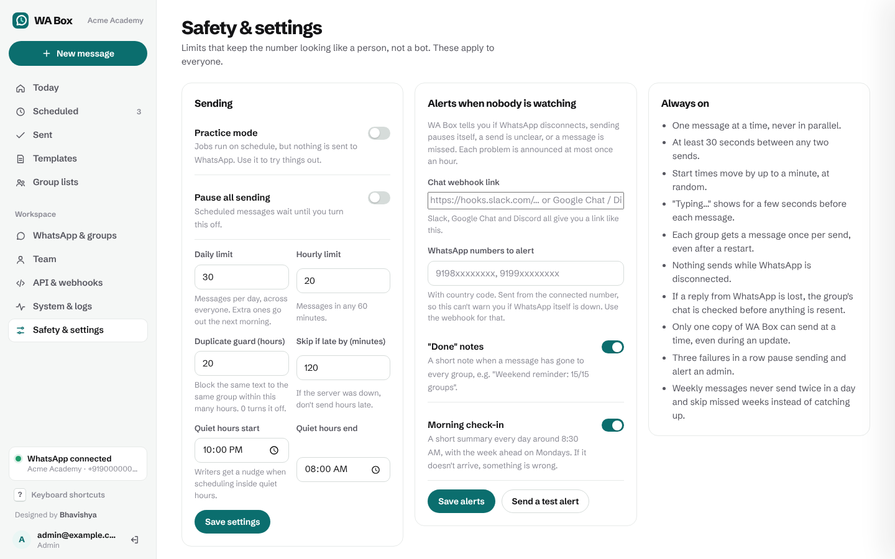

# WA Box user guide

For everyone on the team who writes and schedules messages. Admins: the last sections are for you.

- [Signing in](#signing-in)
- [The Today page](#the-today-page)
- [Writing a message](#writing-a-message)
- [Choosing when](#choosing-when)
- [Before you press Schedule](#before-you-press-schedule)
- [After it's scheduled](#after-its-scheduled)
- [Seeing what was sent](#seeing-what-was-sent)
- [When something didn't go](#when-something-didnt-go)
- [Templates and group lists](#templates-and-group-lists)
- [Keyboard shortcuts](#keyboard-shortcuts)
- [For admins](#for-admins)

---

## Signing in



Your admin gives you a username and a temporary password. The first time you sign in, you choose
your own password (at least 10 characters). After 5 wrong tries the account waits 15 minutes.
You stay signed in for 12 hours of inactivity.

## The Today page


Everything you need on a busy morning:

- **Sending now**: which group just got it, which is next, and when.
- **Coming up today** and the next few days.
- **Needs you**: anything that didn't go out, with what to do about it.
- **Send these again?**: last week's messages, one click to bring them back for this week.

The bar at the top tells you if WhatsApp is disconnected, sending is paused, or WA Box is in
practice mode. The page refreshes itself; while something is sending it updates every few seconds.

## Writing a message


1. **New message** (or press `N`).
2. **Groups**: tick groups, or click a saved list. Search with the box above them.
3. **Message**: type as you would in WhatsApp.
   - `*bold*`, `_italic_`, `~strike~`, ```` ```mono``` ````, `- ` for bullets, `1. ` for numbers, `> ` for a quote. The toolbar adds them for you.
   - Emoji work as they do on your phone.
   - **Placeholders** are filled in for each group:
     - `{group}`: the group's name
     - `{day}`: the weekday it sends, e.g. *Saturday*
     - `{date}`: the date it sends, e.g. *31 Oct*
4. **Image** (optional): drop, paste or choose an image, or paste a public link to one (Google Drive
   links shared with "Anyone with the link" work). Uploaded images are deleted 3 days after sending.
5. **Link preview**: if the message has a link, WhatsApp shows a preview card. Switch it off if you prefer.

The phone on the right shows the message exactly as WhatsApp will. Use the arrows above it to see
what each group gets (useful with `{group}`).

## Choosing when

- **Date and time** are India time. Quick buttons for today, tomorrow and the next days.
- **Repeat every week** on the days you tick. Use `{day}` and `{date}` in weekly messages so the text stays right each week.
- **Pacing** is the random gap between groups:
  - *Gentle* (1–3 min): best for many groups.
  - *Standard* (40 s–2 min).
  - *Custom*. It is never shorter than 30 seconds.
- If you picked a saved list, WA Box suggests the time and pacing you usually use for it.

Below, it tells you when the last group will get it.

## Before you press Schedule

The checks under the preview catch common mistakes:

- **The date doesn't match the text.** "Saturday class starts today" scheduled for Friday, "11 AM today" scheduled for 12:30, a date that has already passed. Press **Fix** to move the send to the right day.
- **Quiet hours**: it would arrive late at night.
- **Unknown placeholders** like `{name}` (would be sent as typed).
- **Short links** and many links, which look like spam.
- **Practice mode** is on, so it won't really be sent.

**Send a test to my WhatsApp** sends the message to the connected WhatsApp number's own chat ("Message
yourself"), so you can see it on a real phone first.

## After it's scheduled


For 30 seconds you can **Undo** (a toast appears, and the message shows a countdown). After that:

- **Scheduled** lists everything coming up by day. Click a message to open it.
- **Edit**, **Duplicate**, **Send now** (starts in 30 seconds), or **Cancel**.
- Just before a weekly message starts, **Skip this time** skips one week and keeps the repeat.
- While it's sending you can **Stop sending**. Groups that already got it keep it.

Messages scheduled by an outside tool through the API show the tool's name, e.g. *Google Sheet (API)*.

## Seeing what was sent


**Sent** has every group of every message:

| Mark | Meaning |
|---|---|
| ✓ | Reached WhatsApp |
| ✓✓ | Delivered to the group |
| Blue ✓✓ | Read |
| Practice | Practice mode: recorded, not sent |

Filter to **Problems** to see only what needs attention. Click a row for the full message.

## When something didn't go

| Status | What happened | What to do |
|---|---|---|
| **Unconfirmed** | WhatsApp didn't answer clearly and the message isn't in the chat. WA Box did **not** resend, to avoid a double message. | Look in the group on your phone. If it's there, press **It was sent**. If not, an admin presses **Send again**. |
| **Failed** | WhatsApp refused it, e.g. the number was removed from the group. | Fix the cause (re-add the number), then **Send again**. |
| **Missed** | It was more than 2 hours late (server or WhatsApp was down). Sending it hours late would confuse people. | Duplicate it with a new time if it still matters. |
| **Duplicate blocked** | The same text already went to that group in the last 20 hours. | Usually right. If it really should go again, **Send again**. |
| **Skipped** | The group is no longer in WA Box's saved list (left, renamed, or no longer matches the keywords). | Sync groups, then duplicate the message. |

If three sends fail in a row, WA Box pauses all sending and tells the admins. That protects the number while someone looks.

## Templates and group lists

- **Templates**: save messages you send often. In a new message, press **Use a template**.
- **Group lists**: save sets of groups ("Weekend cohorts", "Thu–Fri batch") and pick them with one click. A list remembers when it's usually sent.

## Keyboard shortcuts

| Keys | Does |
|---|---|
| `N` | New message |
| `/` | Search groups (when writing) |
| `G` then `T` / `S` / `H` | Go to Today / Scheduled / Sent |
| Ctrl/⌘ + `B` / `I` | Bold / italic |
| Ctrl/⌘ + Enter | Schedule |
| `?` | Show all shortcuts |

---

## For admins

### Connect WhatsApp



1. **WhatsApp & groups → Show QR code**.
2. On the phone: WhatsApp → Settings → **Linked devices** → **Link a device** → scan.
3. **Group keywords**: only groups whose names contain one of these are offered (e.g. *Cohort, Masterclass*). Keep the list short if the phone is in many groups.
4. **Sync from WhatsApp**. Do this again whenever you join or rename groups.

Open WhatsApp on that phone at least once a week; linked devices log out after about 14 days
without the phone. Use a number that has been active for a while.

### Safety & settings



- **Practice mode**: everything runs on schedule, nothing reaches WhatsApp. Turn it off to go live.
- **Pause all sending**: stops everything immediately; scheduled messages wait.
- **Daily and hourly limits** (30 and 20 by default). Over a limit, the rest go out later, not all at once.
- **Skip if late by**: after this many minutes, a send is marked missed instead of going out late.
- **Duplicate guard**: how long the same text is blocked for the same group.
- **Quiet hours**: writers get a warning when scheduling into them.
- **Alerts**: a Slack / Google Chat / Discord webhook, and/or WhatsApp numbers to message. Choose the morning check-in and "done" notes. Press **Send a test alert**.

### Team

Add people as **Member** (write and schedule) or **Admin** (also WhatsApp, team, settings, API).
They choose their own password on first sign-in. **Reset password** and **Disable** are on each row.

### System & logs


Health, decisions waiting for someone, open issues, and the full event log. **Archive** downloads
every send, message and event as CSV. See the [runbook](../RUNBOOK.md) for what to do about each alert.

### API & webhooks

Let other tools schedule messages, or hear about sends. See [API.md](API.md).

---

Designed by [Bhavishya](https://www.linkedin.com/in/bhavishyabharadwaj/).
